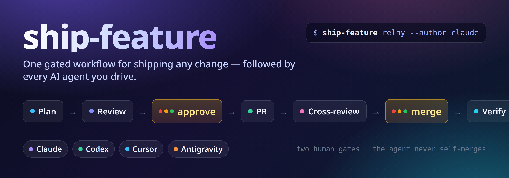

# ship-feature



<div align="center">

[](LICENSE)
[](bin/ship-feature)
[](https://github.com/hamen/ship-feature/actions/workflows/test.yml)
[](https://docs.anthropic.com/en/docs/claude-code)
[](https://github.com/openai/codex)
[](https://cursor.com)
[](https://antigravity.dev)

**One gated workflow for shipping any repository change — followed by whichever AI agent you drive.**

</div>

---

Plan → review → implement → cross-review → merge → verify, with **two human approval gates** and the
agent **never merging its own work**. The process lives in one place — [`WORKFLOW.md`](WORKFLOW.md) — and
each driver agent (Claude, Codex, Cursor) gets a thin adapter that points at it, so you stop re-explaining
"how we ship" every session. Antigravity joins the **cross-review** step through the review relay in
[`relay/`](relay/README.md).

## 🆕 What's new

**v0.7.0** — **the light lane is the default, and pr-review-relay is now part of ship-feature.**

A change that is not risky now skips the plan, the PR and the human merge. The configured panel
reviews it once, then `ship-feature land` merges the branch onto the default branch and pushes it.
The pre-push hook tests the exact tree that lands. Risky changes (payments, consent, auth,
migrations, security, store policy) use the careful lane: one plan-review round, at most two review
rounds, and a human merge. Autonomous mode is gone.

pr-review-relay is now in [`relay/`](relay/README.md), so one clone and one `install.sh` give you the
whole workflow. `install.sh` links `review-local`, `pr-review-relay` and their helpers into
`~/.local/bin`, and `ship-feature review` runs `review-local`. The move does not change the relay's
commands, flags, exit codes or config file. The older history stays in
[hamen/pr-review-relay](https://github.com/hamen/pr-review-relay).

Also in this release:

- **Codex loads the skill.** Codex skips a `SKILL.md` that is a symlink to a file, so it never saw
  ship-feature. `install.sh` now links the skill directory, and it also links the skill where
  Antigravity, Cursor and Junie look for skills. The Codex block and the Cursor rule are now short
  pointers to the skill.
- **An answer without a verdict fails the round.** A review must name a severity or say that the
  change looks good. If it does not, the relay does not post it and exits `3`.
- **`preflight` needs a committed pre-push hook.** It refuses a repository without a committed,
  executable `.githooks/pre-push` that git runs. If the hook is committed but git does not run it,
  run `git config core.hooksPath .githooks`.
- **Two plan-review seats on the `pi` runner**, `pi_glm` and `pi_grok`. They read your checkout
  through read-only tools, so they can check a plan against the code. To use them, set
  `PLAN_REVIEWERS=codex,pi_glm,pi_grok` in `~/.config/pr-review-relay/config`.

**v0.6.0** — **every plan-review seat is pinned from the one shared config, and the seat names stop
lying.** `claude` and `codex` ran bare in plan-review, so `MODEL_claude`, `MODEL_codex` and
`EFFORT_codex` in `~/.config/pr-review-relay/config` pinned the PR review and not the plan review —
codex ran whatever `~/.codex/config.toml` happened to say. They now take `--model` / `--effort` and
`-m` / `-c model_reasoning_effort=…` from the same keys the relay reads, with the environment still
winning; unpinned, they get no extra argument. Each seat's dispatch line now shows what it resolved
to: `→ grok reviewing… (model=grok-4.7, effort=medium)`.

Two seats are renamed because their names described something they no longer ran. **`grok45high` is
now `grok`**: the same seat as the relay's, pinned by `MODEL_grok` / `EFFORT_grok`, at a
configurable effort instead of a hardcoded `high` (the old name still runs `grok`, with a warning).
**`kimi3` is now `glm`** — the opencode runner, which had been carrying GLM for weeks while its
header said Kimi. Old keys are reported and ignored, never silently honoured. See the CHANGELOG for
the full rename tables and two behaviour changes on upgrade: an **unpinned** `glm` seat now runs
`opencode-go/glm-5.3` (it was Kimi K3 — pin `GLM_REVIEW_MODEL` to keep it), and a plan panel that
falls back to a `REVIEWERS` list containing `grok` now runs it, and needs the `grok` CLI installed.

Pairs with **pr-review-relay v1.7.0**, which runs its reviewers in parallel by default, prints the
same resolved-pin line, and stops warning about the `glm` seat.

**v0.5.0** — **one file configures the whole panel, and the panel gains a Gemini seat.** The seats,
their models and the per-reviewer timeout were spread across two config files that were free to
disagree, and nothing complained when they did: `ship-feature` and `pr-review-relay` could run the
same named seat on two different models, or the same round on two different clocks, from inputs that
were each individually valid. `~/.config/pr-review-relay/config` is now the single place the panel is
defined — `REVIEWERS`, `PLAN_REVIEWERS`, `MODEL_*` and `AGENT_TIMEOUT` are all read from it, with the
environment and ship-feature's own config still winning above it. The timeout default moves to 500s,
after a session lost three consecutive `grok45high` attempts to a 300s clock on a plan whose only
fault was being thorough.

**`antigravity`** (aliases `agy`, `gemini`) becomes a real plan reviewer rather than a name that was
silently skipped, running the `gemini` CLI fail-closed: an isolated `GEMINI_CLI_HOME` and workspace
with all four settings scopes redirected to controlled files, a locked `settings.json` that
allowlists only read-only tools, hooks off and no MCP. Because that allowlist does not cover every
tool gemini registers, the seat also **refuses to run against a gemini-cli whose tool registry has
not been audited** — `SHIP_FEATURE_GEMINI_TESTED_VERSIONS`, matched exactly, so a patch release does
not ride in on its neighbour. A panel that lists `antigravity` now requires the binary instead of
thinning itself silently. `kimi3` gained read access to the checkout it reviews.

Also fixed: the macOS CI job had been failing since 2026-08-15 on `grep: maximum repetition exceeds
255` — BSD grep refusing an interval bound the adapter-consistency patterns used, reported as
"missing from every adapter", which named the wrong cause and was invisible on Linux.

**v0.4.0** — **the plan-review panel runs in parallel, and knows when to stop.** Reviewers are
independent, so running them one after another only serialized their timeouts: a four-seat panel at a
300s cap could sit for twenty minutes before printing a verdict, and one real session lost two seats
to timeouts before the third had even started. Parallel is now the default (`--sequential` opts out).
Step 2 also gets its own **2-round cap** — its "iterate (≈2 rounds)" was a suggestion, not a rule, and
one session ran 13 rounds before the panel agreed, burning ~1h15m on convergence instead of on the
plan. Plan-review now stops after round 2 with an open **plan-qualifying** finding (the plan is wrong,
unsafe, or materially incomplete — a distinct term from step 5's PR-qualifying Should-fix) and hands
Gate 1 a **disagreement summary** instead of grinding for consensus; a clean round 1 skips a wasted
round 2 entirely. `WORKFLOW.md`, all three adapters, and the CLI's plan-review message state the same
rule, checked by the same consistency suite as step 5. Plus `GROK45HIGH_REVIEW_MODEL` and
`KIMI3_REVIEW_MODEL`, so a reviewer can be re-pinned when its vendor ships a new model without waiting
for a release.

**v0.3.0** — **the review panel is given the plan, and stops iterating on findings that change
nothing.** Reviewers used to see only the diff, so they could find bugs but never *"this is not what
we agreed to build"* — `--context-file` now carries the plan on every round. And the loop runs in
three named phases (full panel → narrow fix rounds → a closing full panel on the SHA that merges)
instead of iterating on every Should-fix, which had produced eight full-quorum rounds on one PR where
the last five found no Blocker. Both rules live in `WORKFLOW.md`, all three adapters **and** the CLI's
own message — and a consistency suite now fails if any of those five drift apart, in either direction.

**v0.2.0** — **`ship-feature plan-review`**: step 2 as a first-class command, fanning an
implementation plan out to a panel of agents for a read-only review before any code is written.

**v0.1.0** — first release: the canonical `WORKFLOW.md`, a `ship-feature` CLI (`preflight` +
a transparent `relay` wrapper), thin adapters for Claude / Codex / Cursor, an idempotent `install.sh`,
and a two-layer privacy guard. Full history in the [CHANGELOG](CHANGELOG.md).

## Why

Agents reinvent your release/PR process every session — worktree or not, which review, when to merge.
`ship-feature` encodes it once, as instructions an agent actually follows, with the irreversible steps
(approve the plan, merge) held behind explicit human gates.

## The workflow

The authoritative version is [`WORKFLOW.md`](WORKFLOW.md). It has **two lanes**.

**The light lane — the default.** For every change that is not risky:

| Step | What happens |
|:----:|--------------|
| 1 | **Implement** in a worktree, with tests |
| 2 | **One review round by the configured panel**, seats in parallel, on the branch diff (`ship-feature review`), no PR |
| 3 | Fix only what breaks the change for a real user; record the rest |
| 4 | **`ship-feature land`**: merge onto the default branch and push — the pre-push hook tests the exact merged tree |
| 5 | **Ship it**: a change is done when it is live, not when it is merged |

**The careful lane — only for real risk** (payments, consent, auth and account deletion, migrations,
security, store policy):

| Step | What happens | Gate |
|:----:|--------------|:--|
| 1 | **Plan** the change | |
| 2 | The panel **reviews the plan** — one round | |
| 3 | You **approve the plan** | 🚦 **human gate** |
| 4 | **Implement** in a worktree → open a **PR** | |
| 5 | **Cross-review + tests** — the panel gets the **plan**; two rounds at most | |
| 6 | You **merge** | 🚦 **human gate** |
| 7 | **Verify** on the merge commit | |

**Why two lanes.** The careful lane used to be the only lane, with caps of six rounds. A panel of
several models almost always finds one more thing, so the loop did not converge, and one fix could
take days. The light lane trades a few small bugs that reach users for changes that ship the same day;
the careful lane keeps the full gates where a bug costs money, data or trust.

## Install

The review seats need their agent CLIs (`codex`, `claude`, …) and the PR relay needs `gh`; see
[`relay/README.md`](relay/README.md) for the list. Then:

```bash
git clone https://github.com/hamen/ship-feature
cd ship-feature
./install.sh          # or ./install.sh --copy to detach WORKFLOW.md from the clone
```

`install.sh` is idempotent: it symlinks the CLI and the relay's commands (`review-local`,
`pr-review-relay` and their helpers, from `relay/`), installs `WORKFLOW.md` to `~/.config/ship-feature/`, the
workflow skill to `~/.agents/skills/`, a Cursor rule, and a marked block in `~/.codex/AGENTS.md`
(backing up anything it changes). Add a line to your global agent instructions telling it to follow the
ship-feature skill for any feature/fix.

The skill is one directory, `adapters/skill/`, linked as `~/.agents/skills/ship-feature`. Codex,
Gemini CLI, OpenCode, Pi, Qwen and Grok read it there. Claude and Cursor get a link in
`~/.claude/skills/` and `~/.cursor/skills/`. Antigravity and Junie get one in their own skills
directory when the tool is installed (`~/.gemini/config/skills/`, `~/.junie/skills/`). The directory is
the link, not the file: Codex does not load a `SKILL.md` that is a symlink to a file.

The Codex block and the Cursor rule are always loaded, so they are short pointers to the skill file,
not copies of the lanes. They keep one rule, because missing it loses money: a human merges every
careful-lane change. The lane rules live in the skill and in `WORKFLOW.md`, and the suite checks them
there.

## The CLI

- `ship-feature review [args…]` — the light lane's review: a pass-through to `review-local` (in
  `relay/`) with its arguments, stdout and exact exit code. It diffs the current branch against
  `--base` and prints each reviewer's review; nothing is pushed or posted. Typical:
  `ship-feature review --author claude --base origin/main` — no `--reviewers`, so the panel is
  `REVIEWERS` in `~/.config/pr-review-relay/config`. When the change has a plan, add
  `--context-file <plan>`: every seat gets the plan at the head of its prompt, as with the relay.
- `ship-feature preflight` — assert you're in a feature worktree branched off the default branch, with
  the worktree marker git-excluded and a committed `.githooks/pre-push` that git runs on push — the
  pre-push hook every repo needs, running the tests, a linter and a formatter check (run before you
  start implementing).
- `ship-feature plan-review [<file>] [--reviewers a,b,c] [--sequential]` — step 2: fan an implementation
  plan (a file — keep it in `~/.config/ship-feature/plans/`, see WORKFLOW.md §1 — or stdin) out to a panel
  of agents for a **read-only** review and print each
  one. The panel runs **in parallel by default** — the reviewers are independent, so running them one
  after another only serializes their timeouts, and a four-seat panel at the per-reviewer timeout each can sit for many
  minutes before it prints a verdict. Pass `--sequential` to run them one at a time and stream each
  review as it lands. Read-only means each reviewer is pinned to its CLI's read-only mode and none is given a way to
  write your checkout or post anywhere — see [`WORKFLOW.md`](WORKFLOW.md) for what that does and does not
  guarantee for reviewers that run inside the checkout. Defaults the panel to `SHIP_FEATURE_PLAN_REVIEWERS`, then `SHIP_FEATURE_REVIEWERS`; nothing is
  written or posted. Supported reviewers
  are the ones that can actually be constrained: `claude` (`--permission-mode plan --safe-mode`), `codex`
  (`--sandbox read-only`), `cursor` (ask/Q&A mode, pinned to `--model composer-2.5`; see
  [Why the Cursor model is pinned](#why-the-cursor-model-is-pinned)), `glm` (the opencode runner: `OPENCODE_CONFIG_CONTENT`
  — opencode's highest-precedence config layer — denies the `edit`+`bash` permissions so it can't write
  even via shell and can't be overridden by a merged global/checkout config; inherited `OPENCODE_CONFIG*`
  are unset, plus `--pure` and `--agent plan`. It reads the checkout, falls back to an isolated cwd when
  the checkout carries its own opencode config, and is skipped entirely if that cwd cannot be created),
  `grok` (model and effort from `MODEL_grok` / `EFFORT_grok` in `~/.config/pr-review-relay/config` —
  the same keys the relay's grok seat reads — or `GROK_REVIEW_MODEL` / `GROK_REVIEW_EFFORT` in the
  environment; defaults `grok-4.6` / `medium`; `grok45high` is its deprecated old name:
  `grok --prompt-file` — headless Grok ignores stdin — running in
  your checkout like `claude`/`codex`/`cursor`, held read-only by a tool **allowlist**
  `--tools read_file,list_dir,grep`, with the MCP bridge removed explicitly
  (`--disallowed-tools search_tool,use_tool` — it survives the built-in allowlist), plus
  `--permission-mode plan` and `--sandbox read-only`),
  `pi_glm` and `pi_grok` (the `pi` runner, one model each, pinned by `MODEL_pi_glm` / `EFFORT_pi_glm` and
  `MODEL_pi_grok` / `EFFORT_pi_grok` in `~/.config/pr-review-relay/config` — the relay's pi seats read
  the same keys — or `PI_GLM_REVIEW_*` / `PI_GROK_REVIEW_*` in the environment; defaults `zai/glm-5.3` /
  `low` and `xai/grok-4.7` / `low`. They run in your checkout with the tool **allowlist**
  `--tools read,grep,find,ls` — no shell, no write tool — and with extensions, MCP, skills, prompt
  templates, themes, context files, the trust-gated `.pi/` files, the saved session and the startup
  network calls off. An effort that is not one of `off minimal low medium high xhigh max` stops the
  command, because pi itself does not refuse one. The seat needs a `node` >= 22.19.0 (pi's floor) to
  run pi and read its json stream: the PATH one when it meets the floor, else the newest one mise
  installed, never the older Node a reviewed repo pins. Its
  tools can read files outside the checkout too, and what they read goes to the model provider: see
  `WORKFLOW.md` §2),
  and `antigravity` (aliases `agy`, `gemini`) via the `gemini` CLI, run **fail-closed**: an isolated
  `GEMINI_CLI_HOME` and working dir with a locked `.gemini/settings.json` that allowlists only the
  read-only tools via `tools.core`, names today's write tools in `tools.exclude` as defence-in-depth,
  disables hooks, and declares no MCP — so neither the user's real `~/.gemini` nor a reviewed checkout's
  `.gemini/` contributes any `mcpServers`, hooks, or `tools.allowed`. `tools.core` is an allowlist but
  not a universal one — gemini registers some tools outside it — so the seat additionally **refuses to
  run against an unaudited gemini-cli**: only the exact versions listed in
  `SHIP_FEATURE_GEMINI_TESTED_VERSIONS` (default `0.26.0`) are accepted — a patch release can add a tool
  as easily as a minor one — and the version is probed inside the same isolation the review runs in. Model pinned to
  `gemini-3.1-pro-preview` (the CLI's own default is a retired model that 404s); override with
  `SHIP_FEATURE_GEMINI_MODEL` or `MODEL_gemini` in the shared panel file. Tradeoff: the isolated run
  sees only the plan text, not the checkout's files. The `antigravity` name maps to the `gemini` CLI
  here but to `agy` in `relay` — only `gemini` has a read-only mode.
  `--safe-mode` on claude also stops any hooks/plugins/MCP in the checkout from loading.
  `claude` and `codex` are pinned from the same file: `MODEL_claude` / `EFFORT_claude` become
  `--model` / `--effort`, and `MODEL_codex` / `EFFORT_codex` become `-m` /
  `-c model_reasoning_effort="…"`; the environment (`CLAUDE_REVIEW_MODEL`, `CODEX_REVIEW_EFFORT`, …)
  wins. Unpinned, they get no extra argument. Each seat's dispatch line prints what it resolved to.
  Bare `opencode` is
  relay-only and skipped with a warning (a plain `opencode run` uses the
  all-allow `build` agent — only the `glm` reviewer pins the read-only opencode `plan` agent). The
  panel is your quorum — **omit `--reviewers` and it is taken from your config**
  (`SHIP_FEATURE_PLAN_REVIEWERS`, then `SHIP_FEATURE_REVIEWERS`). Each resolves from the
  **environment** first, then `~/.config/ship-feature/config`, then `PLAN_REVIEWERS` / `REVIEWERS`
  in `~/.config/pr-review-relay/config`. Set them in ONE place: an exported value beats both files,
  so a stale one in a shell profile silently reduces the panel. Pass the flag only to override on purpose, because a typed
  list is a copy of that config that goes stale the day a seat is added. A supported reviewer whose
  CLI is missing **fails** the round rather than thinning it — but a **relay-only** name in the set
  (bare `opencode`) is skipped with a warning and the round still exits `0`, so read
  the startup lines. Exit `0` = every reviewer that RAN responded (which is not the same as
  everyone running), `3` = one failed/timed out/returned empty (re-run),
  `1` = usage error. Per-reviewer timeout resolves highest-first: `SHIP_FEATURE_PLAN_TIMEOUT` (the
  environment, then `~/.config/ship-feature/config`), then `PR_RELAY_AGENT_TIMEOUT` from the
  environment, then **`AGENT_TIMEOUT` in `~/.config/pr-review-relay/config`** — the one place to set
  it for this tool and `pr-review-relay` at once — then `500`s. Lets you say "review this plan with codex and glm" as one command.
- `ship-feature relay [args…]` — a **transparent** wrapper over
  [`pr-review-relay`](relay/README.md) (in `relay/`) that preserves its stdout and exact exit
  code, and reminds you what each code means: `0` = every **dispatched** reviewer ran — not that
  everyone ran, since a benched (out-of-quota) seat is dropped and still exits `0` — and not "clean";
  `3` = re-run; `4` = take the open findings to Gate 2. It injects your configured reviewer quorum when you omit
  `--reviewers` — **which is how it should normally be run**: the config is the panel, and a typed
  list can only be staler than it. Pass the flag only to override. Read
  each round's startup lines either way: omitting the flag fixes a stale list, it cannot tell you a
  seat dropped out — a **benched** (out-of-quota) reviewer is skipped and the round still exits
  `0`.

State/resume (`new`/`status`) is intentionally deferred — the CLI stays a thin helper; the agent drives
the process from `WORKFLOW.md`.

## Why the Cursor model is pinned

`plan-review` invokes the Cursor reviewer with `--model "$CURSOR_REVIEW_MODEL"`
(default `composer-2.5`). Left off, `cursor-agent` uses whatever is in your
`~/.cursor/cli-config.json`, which out of the box is **Auto** — and Auto routes to the frontier
models, including Claude's.

That matters more here than anywhere else in the pipeline. `plan-review` is the check on a plan that
an agent — usually Claude — just wrote, immediately before a human approves it. If Auto picks a
Claude model, Claude grades its own plan while the panel prints it as an independent "Cursor"
reviewer. The gate still reports two reviewers; you actually have one. Pinning to a model from a
different family is what keeps the second opinion a second opinion.

It also stops the reviews from billing Cursor's small *Other Models* quota (Claude/GPT) instead of
the much larger Cursor-branded pool — a real problem for a command you run before every change.

The default is **Composer 2.5, Cursor's own model**: Cursor-pool, and not Claude, GPT, Codex or
Grok. Every reviewer on the panel then stays on the model its own vendor built, which keeps them
failing differently from each other and not just from the author.

Override with `CURSOR_REVIEW_MODEL`; `cursor-agent --list-models` shows what your account offers.
**Pick something outside the other reviewers' families.** Setting it back to `auto`, to a
`claude-*` id while Claude writes your plans, or to a `cursor-grok-*` id while `grok` is on
your panel, all collapse two nominally independent seats onto one model family — the override
exists for retired model ids, not for going back to Auto.
The variable has no `SHIP_FEATURE_` prefix on purpose: it describes your Cursor account rather than
this tool, [`pr-review-relay`](relay/README.md) reads the same one, and a
single setting should configure both. It **is** read from config (and exported when read, so the
relay child process sees it). Three sources, highest first: the environment,
`~/.config/ship-feature/config`, and finally `pr-review-relay`'s own config as `MODEL_cursor`.

## Overriding the glm model

`plan-review` invokes the `glm` reviewer with `opencode run --pure --agent plan -m
"$GLM_REVIEW_MODEL"`. On OpenCode v2, which has no `--pure`, it runs `opencode run --standalone`
with an empty `OPENCODE_CONFIG_DIR`, so a model on a provider defined only in your `opencode.json`
is not found there. (Default `opencode-go/glm-5.3`, the bundled OpenCode Go tier). Override with
`GLM_REVIEW_MODEL` to route it at a different model instead — for example a pay-as-you-go
OpenRouter id (`openrouter/z-ai/glm-5.3`) if you want the seat off the bundled subscription tier
without waiting on its quota reset. `opencode models` lists what your account can reach.

**The seat is the runner, not the model.** `glm` names the opencode runner pinned read-only, and the
model is this one setting. That is also why the seat was renamed: it was called `kimi3` until
2026-09, by which point it had been running GLM for weeks, and the panel header named a model that
had not reviewed anything. If you pin this seat back at a Moonshot id the seat name will lie again —
the name records what it usually runs, not a guarantee.

Same convention as `CURSOR_REVIEW_MODEL`: no `SHIP_FEATURE_` prefix, read from
`~/.config/ship-feature/config` with the environment winning, and from `pr-review-relay`'s own
config as `MODEL_glm` below that — which is normally where a pin belongs, since both tools drive
the same seats on the same accounts. The config SOURCE is shared; the SEAT is not — unlike `CURSOR_REVIEW_MODEL`, this reviewer has no counterpart in
`pr-review-relay` — that tool's opencode reviewer has its own separate override,
`PR_RELAY_OPENCODE_MODEL`, for a different code path (the relay's `opencode` seat, not
plan-review's `glm` seat).

### Migrating from `kimi3`

The old names are **ignored, with a warning** — never silently honoured, because a config that names
a dead key while the seat runs something else is the defect the rename removes:

| old | new |
|---|---|
| `kimi3` in **any** reviewer list | `glm` — the old name fails the round as an unknown reviewer |
| `KIMI3_REVIEW_MODEL` (environment or `~/.config/ship-feature/config`) | `GLM_REVIEW_MODEL` |
| `MODEL_kimi3` in `~/.config/pr-review-relay/config` | `MODEL_glm` |

**"Any reviewer list" means all four sources**, and the panel falls back through them in this
order — rename `kimi3` in every one you have set, or the round still fails:

1. `--reviewers` on the command line;
2. `SHIP_FEATURE_PLAN_REVIEWERS` (environment, then `~/.config/ship-feature/config`);
3. `SHIP_FEATURE_REVIEWERS`, the same two places;
4. `PLAN_REVIEWERS`, then `REVIEWERS`, in `~/.config/pr-review-relay/config` — **the usual home**,
   and the one most likely to be the line you actually have to edit.

The warnings are printed by `plan-review` only, not by `relay` or `preflight`. `pr-review-relay`
before v1.7.0 printed one `no reviewer seat named 'glm'` warning per run for a `MODEL_glm` key it does
not read; v1.7.0 knows the seat, so upgrade both together.

## Running the tests

```bash
bash test/test-ship-feature.sh
```

Needs **git 2.31+**. The suite isolates its fixtures from your own git environment — signing, hooks,
`core.excludesFile`, and the `GIT_DIR` family that git hands to hooks — using `GIT_CONFIG_COUNT`,
which arrived in 2.31. On an older git it refuses to run rather than applying half the isolation and
reporting green. That isolation is why the suite behaves the same whether or not your commit signing
is on, and why running it from a git hook cannot write into the repository being tested.

The suite is a stage of the full gate, `bin/ci`, and the relay's own gate runs after it:

```bash
bin/ci   # syntax (bash -n), shellcheck -S warning, shfmt -i 2 -ci -d, leak scan, the suite, relay/bin/ci
```

It finds every tracked shell file by extension or shebang, and it needs `shellcheck` and `shfmt` at
exactly the versions [`mise.toml`](mise.toml) pins: run `mise install` in the repo, or install those
versions another way. shellcheck and shfmt skip `relay/` until a commit of pure tool output brings it
to the same bar; `relay/bin/ci` checks the relay's syntax and runs its suites, and needs `jq` 1.7+
and `node`. CI runs the same script on ubuntu and macOS.

**The pre-push hook.** `.githooks/pre-push` runs `bin/ci` on every push. Turn it on once per clone
(every worktree of the clone shares it):

```bash
git config core.hooksPath .githooks
```

Then every agent or person who pushes from that clone needs the pinned tools on `PATH`; without them
the push is refused with the install hint. The fix is to install them, never to skip the hook. The
hook also refuses a push of anything but the checked-out `HEAD`, a dirty tree, and an untracked file
that no ignore rule covers (`.gitignore`, `.git/info/exclude` or your global ignore file): commit
it, delete it, or ignore it. It refuses a tracked file marked assume-unchanged or skip-worktree too,
because `git diff` cannot see an edit to one. A push takes about 2 minutes, most of it the suite.

One commit only reformatted the shell code with shfmt, and
[`.git-blame-ignore-revs`](.git-blame-ignore-revs) lists it. GitHub skips it in blame on its own; for
a local `git blame`, run
`git config blame.ignoreRevsFile .git-blame-ignore-revs` (on a branch without that file, `git blame`
then fails, so set it only where you need it).

## Keeping it clean (privacy)

This repo is generic — no private, project-specific data. Two guards:

- **`scripts/scan-generic.sh`** (CI and the pre-push hook, through `bin/ci`) — catches real emails and
  absolute home paths; needs no config, runs on fork PRs.
- **`scripts/scan-personal-data.sh`** (local, pre-publication) — greps full history, commit metadata,
  filenames, and ref names against a **private** newline-delimited deny-list file (never `source`-d).

Your machine-specific values live in `~/.config/ship-feature/config` (gitignored) — see
[`config.example`](config.example).

## License

MIT © 2026 [Ivan Morgillo](https://github.com/hamen) — see [LICENSE](LICENSE).
